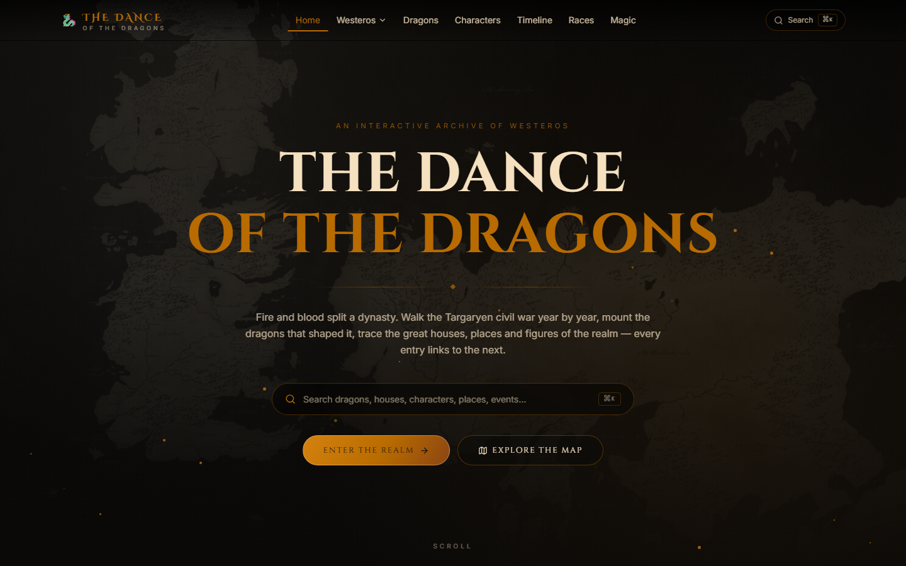
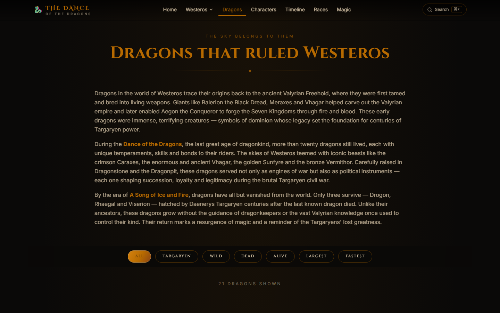
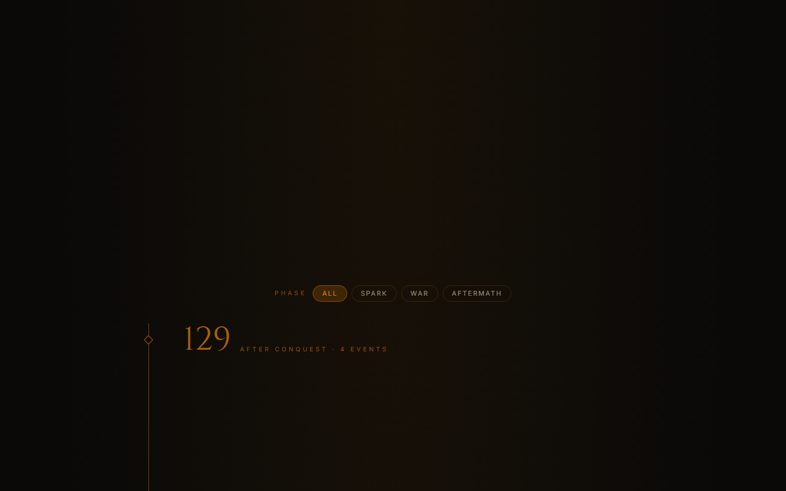
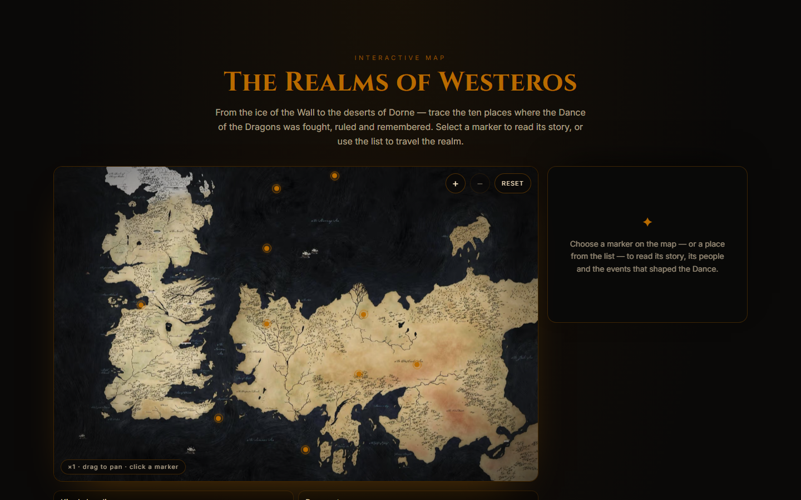
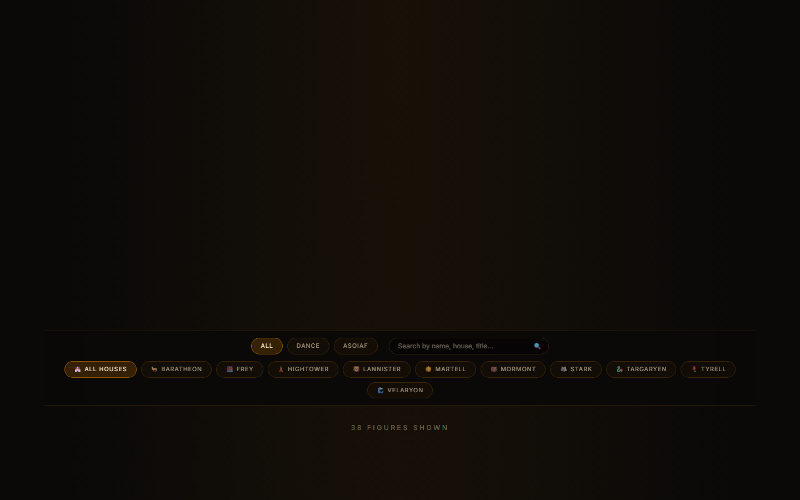
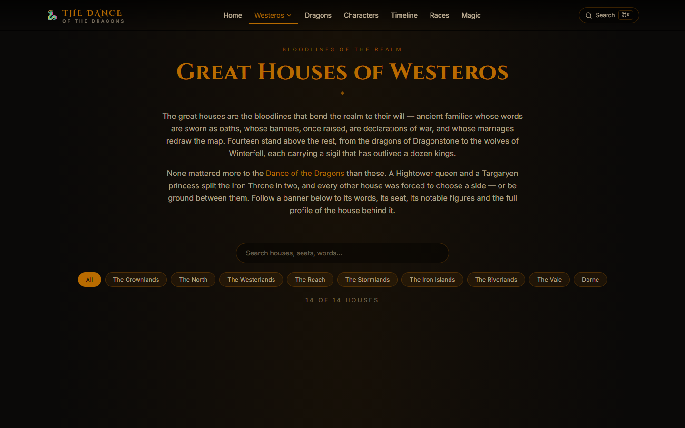

# A Song of Ice and Fire — The Dance of the Dragons

**A cinematic, fully interactive encyclopedia of the Targaryen civil war — the Dance of the Dragons — bringing 21 dragons, 14 great houses, 38 characters, 10 locations and an 18-event chronicle of Westeros into one connected, searchable archive.**

Fire and blood split a dynasty. This project turns the lore of Westeros into a
living, connected archive: dragons, great houses, characters, locations,
organizations, magic and a year-by-year chronicle of the war — where every
entry links to the next, and one command palette (`⌘K`) searches all of it
at once.



## Features

- **Cinematic homepage** — full-screen Westeros hero with rising embers, a global
  search entry point and direct paths into every section of the archive.
- **Global navigation & search** — grouped navigation (Westeros ▾, Dragons,
  Characters, Timeline, Races, Magic) plus a `⌘K` command palette that searches
  characters, dragons, houses, locations and events at once.
- **Dragon profiles** — 21 dragons with epithets, riders, colour, status,
  segmented stat bars (size / age / combat / speed), known battles and lore,
  plus filters: `All · Targaryen · Wild · Dead · Alive · Largest · Fastest`.
- **Dance timeline** — 129 → 153 AC, phase filter (Spark / War / Aftermath),
  expandable events with outcomes and deep links (`/timeline#battle-of-rooks-rest`).
- **Interactive map of Westeros** — clickable markers, zoom & pan, a detail
  drawer with holder, house, notable figures, key events and nearby locations.
- **Character database** — era and house filters, searchable roster, full
  profile pages cross-linked to dragons, houses and events.
- **Great houses** — words, region, seat, notable figures and dragons for the
  fourteen great houses, with individual house pages.
- **Consistent design system** — near-black ink, aged gold and blood red,
  serif display headings over a clean sans body, glass panels and restrained,
  cinematic animation (reveals, hover lifts, embers — no endless glow).

## Screenshots

| Homepage | Dragons | Timeline |
| --- | --- | --- |
|  |  |  |

| Map | Characters | Houses |
| --- | --- | --- |
|  |  |  |

## Tech stack

- [Next.js 16](https://nextjs.org) (App Router, React 19, Server Components)
- TypeScript (strict) + Tailwind CSS v4
- Framer Motion for reveals and page motion, Embla for carousels
- Local content layer — no CMS, no database: typed data modules under `src/data`

## Getting started

```bash
npm install
npm run dev        # http://localhost:3000
```

Other scripts:

```bash
npm run build      # production build
npm run start      # serve the production build
npm run typecheck  # tsc --noEmit
npm run lint       # eslint
```

## Architecture

```
src/
├── app/                  # routes (App Router)
│   ├── page.tsx          # cinematic homepage
│   ├── dragons/          # roster + /dragons/[slug] profiles
│   ├── characters/       # roster + /characters/[slug] profiles
│   ├── greathouses/      # house index (route kept for compatibility)
│   ├── houses/[slug]/    # house profiles
│   ├── locations/        # index + /locations/[slug] entries
│   ├── map/              # interactive Westeros explorer
│   ├── timeline/         # chronicle of the Dance
│   ├── organizations/ races/ magic/ lobby/
│   ├── layout.tsx        # fonts, metadata, nav, footer
│   └── globals.css       # design tokens + shared component classes
├── components/           # Navigation, SearchOverlay, Footer, ScrollReveal…
├── data/                 # the content layer
│   ├── types.ts          # shared entity contract
│   ├── dragons.ts characters.ts houses.ts locations.ts events.ts
│   └── search.ts         # built-in cross-archive search index
└── lib/                  # fonts, link/href helpers, utils
```

**Cross-linking model.** Every entity stores its relationships as
`{ type, slug, label }` references; `src/lib/links.ts` is the single place that
turns a reference into a route. Adding a new relationship type only requires a
new route case, and search, chips and profiles all agree.

## Roadmap

- [x] Redesigned cinematic homepage with hero, quick navigation and search
- [x] Global navigation with grouped menu and `⌘K` search palette
- [x] Dragon profiles with stat bars, battles and roster filters
- [x] Dance of the Dragons timeline with deep-linkable events
- [x] Interactive Westeros map with detail drawer and zoom/pan
- [x] Character database with profiles and cross-links
- [x] Great house profiles
- [x] Shared design system (gold / blood / ink, serif + sans)
- [ ] Audio quotes and ambient sound toggles
- [ ] Battle simulator / comparison view for dragons
- [ ] Community contributions: fan art & essay section

## Contributing

Contributions are welcome — lore corrections, new entries, translations and UI
polish. A typical contribution:

1. Fork and create a branch.
2. Add or edit content in `src/data/*.ts` (follow the types in
   `src/data/types.ts` — links are `{ type, slug, label }`).
3. Run `npm run typecheck` and `npm run build`.
4. Open a pull request describing the change.

## Disclaimer

This is a non-profit fan project. All characters, lore and imagery belong to
George R.R. Martin, HBO and the associated rights holders. No infringement is
intended.

---

<sub>**Repository topics:** `asoiaf` · `game-of-thrones` · `house-of-the-dragon` · `westeros` · `targaryen` · `dragons` · `fantasy` · `nextjs` · `typescript` — find them under **About** on the repo homepage, or suggest new ones in an issue.
